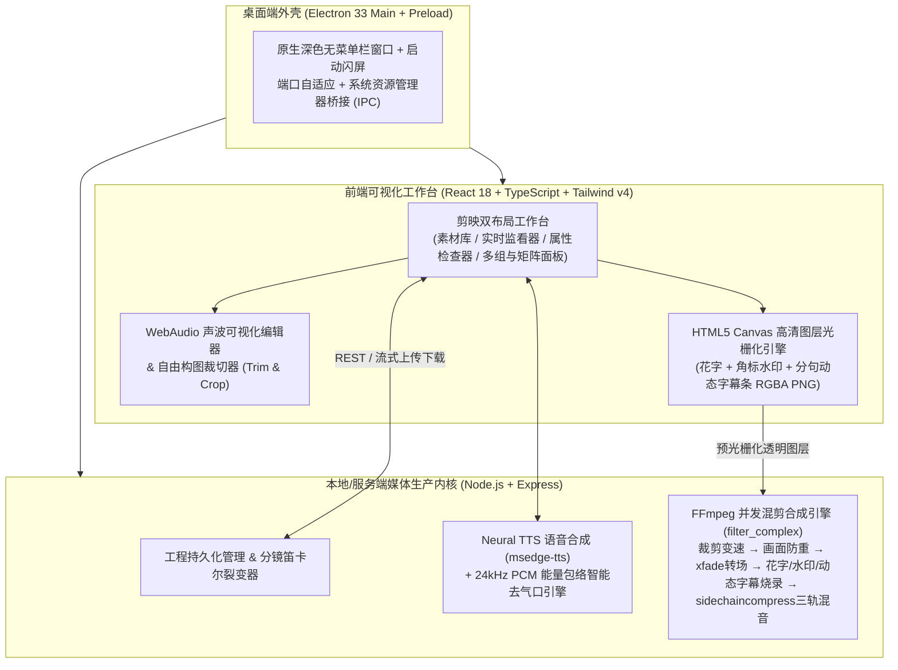

<div align="center">

# 流剪矩阵 FlowCut Studio (FlowCut Pro)

**剪映专业版交互体验 × 工业级批量混剪裂变引擎**  
面向信息流广告投流、电商带货种草、本地生活探店与短视频矩阵运营的 **Web + Windows/macOS 原生桌面双栖生产工作台**

[](https://github.com/DreamTwT/FlowCut-Studio/releases)
[](https://github.com/DreamTwT/FlowCut-Studio/actions)
[](https://www.typescriptlang.org/)
[](https://react.dev/)
[](https://www.electronjs.org/)
[](https://ffmpeg.org/)
[](LICENSE)

[**📦 下载桌面安装包 (Releases)**](https://github.com/DreamTwT/FlowCut-Studio/releases) · [**🐛 提交问题 (Issues)**](https://github.com/DreamTwT/FlowCut-Studio/issues) · [**💡 新特性讨论 (Pull Requests)**](https://github.com/DreamTwT/FlowCut-Studio/pulls)

</div>

---

## 📖 项目简介

在巨量千川、磁力金牛、腾讯广告及抖音/小红书自然流矩阵运营中，一条爆款产品往往需要测试 **「多个前 3 秒吸睛钩子 × 多组核心卖点实拍 × 多套促销引导语 × 不同口播配音」** 的数十种排列组合。

- 传统单轨非线性剪辑软件（如剪映、Premiere）**精修体验好，但逐条复制改字导出 30 条成片极度耗时**；
- 传统命令行/云端黑盒混剪脚本 **虽能跑量，但无法实时预览构图、无法逐素材裁切画面、无法微调口播气口与动态字幕**，容易产出穿帮废片。

**流剪矩阵 FlowCut Studio** 将两者深度融合：**前端复刻剪映专业版的深色可视化交互体验（实时监看、双布局切换、自由构图裁切、可视声波剪辑、WYSIWYG 字幕/花字/水印预览），底层基于原生 FFmpeg 复杂滤镜图（`filter_complex`）与神经语音合成引擎，一键并发输出可直接用于商业投流的 H.264/AAC 高清 MP4 成片。**

---

## ✨ 核心功能全景

### 1. 双模式混剪编排工作流
- **成片视频组精编模式**：支持创建多条独立成片组，每组自由拖拽排序视频/图片片段、独立配置转场、花字、口播、动态字幕、水印与背景音乐，支持单组或勾选多组批量导出。
- **分镜矩阵槽裂变模式（Matrix Mixer）**：自定义分镜阶段（如：`🔥 前3秒吸睛开头` → `💡 痛点场景` → `💎 核心卖点实测` → `🎯 促销转化 CTA`），配置标题文案池、口播池与配乐池，支持 **全量笛卡尔积组合** 或 **智能均衡抽样去重** 一键裂变生成数十条成片组。

### 2. 剪映风格竖屏 / 横屏双布局工作台
- **竖屏布局（短视频推荐）**：左侧宽幅网格素材库 + 中间属性精修面板 + 右侧从顶到底全高沉浸式 9:16 监看器。
- **横屏布局（经典三栏）**：左上素材库 + 中间监看器 + 右侧属性检查器 + 底部全宽多轨视频组/矩阵面板。
- 全界面支持鼠标拖拽分割条自由缩放各区域宽高比例，内置 9:16 抖音/快手 UI 安全区参考线叠层与 `Ctrl+Z / Ctrl+Y` 多步撤销重做。

### 3. 帧级非破坏性时长截取（Trim）与画面自由裁切（Crop）
- **素材默认裁剪 & 片段独立覆写**：既可在素材库对原片做一次预设裁剪（后续拖入任意组自动生效），也可在具体成片组内针对单个片段单独精修。
- **自由构图框 + 画幅适配**：内置可视化九宫格拖拽裁切框（支持横屏 16:9 实拍素材框选核心主体转为 9:16 竖屏特写），提供 **智能裁切满屏（Cover）**、**磨砂高斯模糊填边（Blur Backdrop）**、**黑边完整居中（Contain）** 三种填充算法及 `0.5x ~ 2.0x` 片段变速。
- **丝滑衔接转场**：支持无转场硬切、柔和叠化（`fade`）、向左滑入（`wipeleft`）、纵向平滑推入（`smoothup`）、圆形展开（`circleopen`）。

### 4. AI 拟真文字转配音 + 智能去气口 + 可视声波剪辑 + 三轨自动闪避混音
- **多主播神经语音合成（Neural TTS）**：内置 8 款高自然度中文主播音色（带货女声、种草少女、沉稳解说男声、热血促销男声、温柔台湾腔、纯正粤语等），支持语速/语调微调及 **多条文案一键批量合成并自动分发至各成片组**。
- **24kHz PCM 能量包络智能去气口**：毫秒级扫描音频能量包络（支持轻度自然 / 标准信息流 / 极限紧凑逼单三档预设及自定义 dB 阈值），自动切除换气停顿与句间拖沓空白，保留防吞字微衔接（45ms），支持无损输出紧凑新音频。
- **可视声波剪辑台**：双柄拖拽截取音乐高潮副歌（Chorus）、支持淡入淡出包络（Fade In/Out）与试听。
- **专业三轨混音与智能闪避（`sidechaincompress`）**：底层同时混音「视频原声 + 口播配音轨 + BGM 背景音乐轨」，开启智能闪避后，口播人声响起时自动压低背景乐，人声停顿时平滑恢复。

### 5. 口播同步动态字幕（Synced Subtitles）与爆款花字贴片
- **配音自动对齐时间轴字幕**：文字转配音完成时，自动按中文语义标点切句并精准对齐去气口后的真实配音时长，生成逐句动态字幕。
- **任意台词一键切轴 & 逐句微调**：支持粘贴外录口播台词按成片时长智能切分，支持逐句修改起止秒数与文案、内置 **5 套剪映动态字幕预设**、一键导出标准 **`.srt` 字幕文件**，导出 MP4 时按时间戳真实分段烧录（`enable='between(t,t0,t1)'`）。
- **上下固定吸睛花字**：支持顶部大标题 + 底部转化引导语双贴片，内置抖音柠檬黄、大促红底白字、磨砂黑底胶囊、科技冰青等 **6 套剪映爆款花字样式**，支持一键仅同步样式或连同文案覆盖至全部成片组。

### 6. 品牌角标 / 透明 LOGO 水印与四维过审级深度防重引擎 (v2.1+)
- **品牌角标与透明 LOGO 水印**：支持文字胶囊角标与上传本地透明 PNG 品牌 LOGO 两种模式，四角快捷定位、缩放、透明度与边距无级调节，支持一键同步挂载到全部成片组。
- **四维过审级批量防重（4D Anti-Duplicate）**：支持 **底层画面水平镜像**、**微缩放裁边去重**、**微旋转 + 色彩微扰**、**音频微变速变调防重（0.97x~1.04x 改写声纹指纹）**、**动态隐形扫光粒子层** 以及 **导出一键剥离元数据 + 随机收尾帧微抖动**。
  > **图层隔离保护**：所有防重滤镜仅作用于底层视频流，**绝不翻转顶部的花字标题、口播动态字幕与品牌角标**！

### 7. AI 爆款脚本裂变 & 双模原声语音识别转字幕 (v2.2+)
- **统一「AI 脚本裂变与智能配音中心」**：内置硅基流动（免费模型直连）、DeepSeek、阿里通义千问、智谱 GLM、火山豆包及本地 Ollama 预设（密钥仅保存在本机 gitignore 的 `storage/_ai_config.json`），同时内置零 Key 千川六大投流公式兜底；输入商品卖点即可一键裂变多套 **「前3秒钩子口播 + 顶部吸睛花字 + 底部转化 CTA」**，并一键完成 Neural TTS 配音、24kHz 去气口精修与全组/矩阵池投递。
- **双模原声语音识别提取动态字幕（ASR + 16kHz VAD 开口对轴）**：支持直接识别视频片段真人原声或外录配音轨，提供 **「☁️ 云端极速识别（SenseVoiceSmall / Whisper，复用同一 API Key 1秒出字）」** 与 **「💻 本地免 Key 离线识别（WebAssembly 量化 Whisper，国内镜像按需自动缓存）」** 双引擎切换，配合 16kHz 自适应能量门限 VAD 自动对齐每段开口起止时间轴。

### 8. 长视频智能镜头拆条、音乐鼓点卡点 & 音画时长自动对齐 (v2.3+)
- **长视频智能拆条工作台（`FFmpeg scdet` 零拷贝秒拆）**：一键扫描长实拍视频中的机位/镜头转场突变点（一镜到底视频自动支持固定节奏秒数均分），自动提取每个子镜头封面并按千川叙事顺序打标（`吸睛开头 → 痛点场景 → 核心卖点 → 促销CTA`），支持零磁盘冗余秒拆入库或**按标签一键自动塞入分镜矩阵槽**。
- **BGM 音乐鼓点探测与自动卡点（Beat-Sync）**：通过 16kHz 低频重音（240Hz IIR 滤波）+ 频谱瞬态通量（Onset Flux）自动计算音乐 BPM 与重拍时间戳（支持声波剪辑台金色节拍线可视化），一键将单组或全部视频组的镜头切换精准对齐音乐鼓点（自动补偿 `xfade` 转场重叠时长）。
- **音画时长智能对齐（Audio-Video Auto-Align）**：多视频组列表实时检测「画面总长 vs 口播配音总长」偏差，提供 **智能混合对齐（优先展缩原片冗余保持 1.0x 原速，不足再微变速）**、**均匀变速画面** 与 **反向微调口播倍速（同步缩放硬字幕时间轴，保留鼓点卡点）** 三种策略，支持单组或全组一键防截断/防黑尾。

### 动态运镜、网感音效与封面同步导出 (v2.4+)
- 为每个图片或视频片段选择推拉、平移或开场冲击运镜；也可在矩阵生成及成片组中智能编排。
- 内置合成音效包，可设置开场、转场和结尾音效及音量，并在播放器中试听。
- 批量导出可选视频封面截帧，JPG 与 MP4 一起提供下载及 ZIP 打包。上述三项导出功能需要桌面版或本地服务；浏览器独立预览模式不支持。

### 9. GPU 硬件加速编码与多线程 FFmpeg 批量渲染 (v2.1+)
- 启动自动真实编译探测 **NVIDIA NVENC (`h264_nvenc`) / Intel QSV (`h264_qsv`) / AMD AMF (`h264_amf`) / Apple VideoToolbox** 硬件编码器，支持 **GPU 极速模式（并发最高 6 路，提速 3~5 倍）** 与 **CPU x264 精压模式** 自由切换，渲染异常自动无感回退 `libx264`。
- 支持 `9:16` / `16:9` / `1:1` 画幅、`1080P` / `720P` 分辨率、`30fps` / `60fps` 帧率、`CRF 20 / 23` 码率控制与 `{project}_{index}_{group}` 变量化自动命名；桌面端一键唤起系统资源管理器定位成片，Web 端支持流式打包 `.zip`。

---

## 🏗️ 系统架构



---

## 📂 目录结构

```text
FlowCut-Studio/
├── .github/workflows/
│   └── release-desktop.yml         # GitHub Actions 自动编译发布 Windows .exe 工作流
├── client/                         # 前端 React 可视化工作台源码
│   └── src/
│       ├── components/             # 核心面板与弹窗组件 (监看器/检查器/矩阵器/声波剪辑等)
│       ├── utils/overlayCanvas.ts  # 客户端高精度 Canvas 文字/水印/字幕条光栅化器
│       ├── localEngine.ts          # 纯前端单文件离线体验引擎
│       └── App.tsx                 # 主工作台布局、撤销重做栈与全局状态调度
├── server/                         # Node.js 媒体处理与渲染后端源码
│   ├── index.ts                    # Express API 路由与静态流媒体服务 (Range 支持)
│   ├── renderEngine.ts             # FFmpeg 复杂滤镜图构建与并发渲染队列调度
│   ├── audioProcessor.ts           # 24kHz PCM 能量包络去气口与音频波形裁剪引擎
│   ├── ttsEngine.ts                # 多音色 Neural TTS 合成管线
│   ├── overlayRenderer.ts          # 服务端图层解码与 SVG/Sharp 兜底渲染器
│   ├── ffmpegBootstrap.ts          # 阿里云国内镜像自动初始化 FFmpeg / FFprobe
│   ├── projectStore.ts             # JSON 工程存储与分镜矩阵均衡裂变算法
│   └── seedDemo.ts                 # 首次启动自动生成高仿真多场景演示工程
├── shared/
│   └── schema.ts                   # 前后端共享类型定义、花字/字幕预设、SRT 导出与防重算法
├── desktop/                        # Electron 原生桌面客户端模块
│   ├── main.cjs                    # 桌面主进程 (内嵌服务守护、动态端口、IPC 目录唤起)
│   ├── preload.cjs                 # 安全上下文桥接脚本
│   ├── bootstrap-desktop.cjs       # 免 npm 绿色便携桌面引导器
│   └── icon.ico / icon.png         # 多尺寸高清应用图标
├── scripts/                        # 跨平台构建与打包工具链
│   ├── build-mode-b.cjs            # Windows 自动清理 + 国内镜像安装打包编排器
│   ├── dist-desktop.cjs            # 预内置离线 FFmpeg/FFprobe 并调用 electron-builder
│   └── afterPack.cjs               # 纯 JS (resedit) 内存写入 PE 图标与属性 (防杀软锁死)
├── electron-builder.yml            # 标准 Windows NSIS / Portable / macOS DMG 打包配置
├── .npmrc                          # 国内淘宝 npmmirror 全量镜像源配置
└── Build-Windows-Installer-ModeB.bat # 一键编译 Windows 标准安装包 (.exe)
```

---

## 🚀 快速开始与编译打包

> **环境要求**：**Node.js >= 18（推荐 Node 20 / 22 LTS）**。无需手动配置全局 FFmpeg 或 Python / Visual Studio C++ 编译环境，系统内置全自动国内镜像引导。

### 1. 本地全栈开发模式（Web 热更新）

```bash
git clone https://github.com/DreamTwT/FlowCut-Studio.git
cd FlowCut-Studio

# 安装依赖 (仓库已内置 .npmrc 国内淘宝镜像源)
npm install

# 启动前后端一体化开发服务 (访问 http://localhost:3000)
npm run dev
```

### 2. 编译标准 Windows / macOS 桌面安装包（`electron-builder`）

工程已针对国内网络环境与 Windows 安全软件文件锁做了深度工程适配（全程走阿里云 `npmmirror` 镜像、自动内嵌离线 `ffmpeg.exe` + `ffprobe.exe`、采用纯 JS `resedit` 内存写入 `.exe` 图标以彻底规避 `rcedit` 报错）：

- **Windows 一键编译**：双击根目录 **`Build-Windows-Installer-ModeB.bat`**
- **命令行编译**：
  ```bash
  npm install
  npm run dist:win   # Windows: 输出 NSIS 安装包 + 单文件便携版 .exe
  npm run dist:mac   # macOS: 输出 .dmg 与 .zip
  ```
- **编译产物**（输出至 `release-desktop/` 目录，内置离线 FFmpeg，终端用户安装即用）：
  - `FlowCut-Pro-Setup-v2.0.3-x64.exe`（标准向导式安装包，支持自选安装目录与桌面快捷方式）
  - `FlowCut-Pro-Portable-v2.0.3-x64.exe`（单文件绿色免安装便携版）

### 3. GitHub Actions 云端自动发版

仓库已内置 `.github/workflows/release-desktop.yml`。推送任意 `v*` 版本标签即可触发云端自动编译并发布安装包至 [GitHub Releases](https://github.com/DreamTwT/FlowCut-Studio/releases)：

```bash
git tag v2.0.3
git push origin v2.0.3
```

---

## 🌿 分支规范与协作研发

- **`main`**：稳定基线与正式版本发布分支（对应 `Releases` 安装包）。
- **`dev`**：日常特性集成与下一阶段新功能联调分支。
- **`feat/*`**：单项新特性研发分支（例如 `feat/gpu-nvenc`、`feat/ai-script-fission`、`feat/whisper-asr`）。

---

## 🗺️ 后续演进路线图（Roadmap）

- [ ] **AI 爆款文案裂变**：接入 DeepSeek / 通义千问 / OpenAI 兼容接口，输入商品卖点一键生成口播脚本与花字池
- [ ] **本地/云端 ASR 语音识别**：集成 Whisper / Paraformer，支持外录真人原声视频一键提取逐句时间戳字幕
- [ ] **GPU 硬件编码加速**：支持 `h264_nvenc` / `h264_qsv` / `h264_amf` / `videotoolbox` 显卡极速并发合成
- [ ] **高阶电商视觉组件**：画中画（PiP 主播讲解角窗）、绿幕抠像（Chroma Key）、静态图动态推拉运镜（Ken Burns）
- [ ] **网感音效与行业调色**：内置免版权综艺/转场/收银音效库（SFX）与 3D LUT 行业滤镜
- [ ] **投流归因与行业模板**：导出巨量千川素材归因 Excel/CSV 台账，支持 `.fcpack` 行业模板导入导出

---

## 📄 开源协议

本项目基于 [MIT License](LICENSE) 协议开源。Copyright © 2026 [DreamTwT](https://github.com/DreamTwT).
